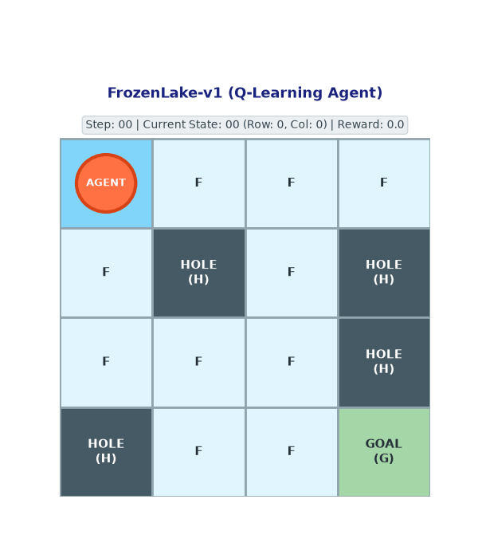
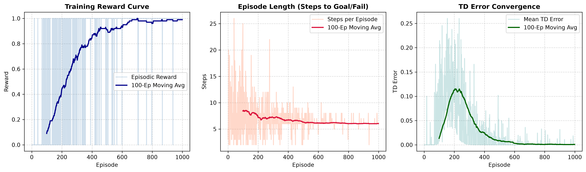
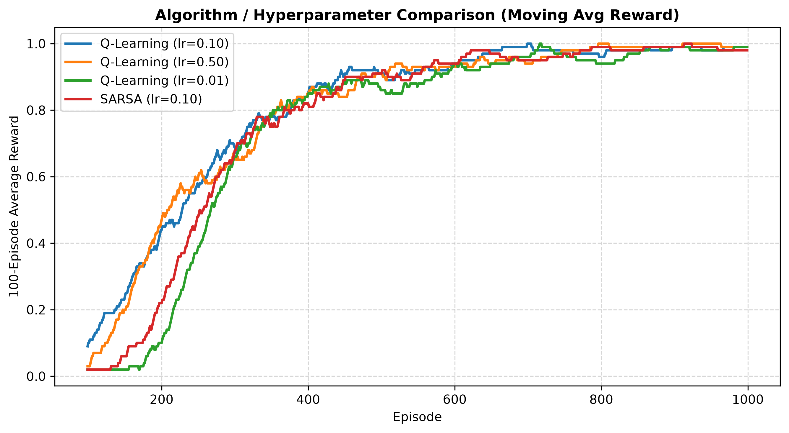

<div align="center">


# Custom Reinforcement Learning Agent Implementation
### Benchmark Grid-World Decision Making with Farama Gymnasium

[](https://www.python.org/)
[](https://gymnasium.farama.org/)
[](https://numpy.org/)
[](https://matplotlib.org/)
[](https://opensource.org/licenses/MIT)

---

**Course:** Topics in AI (`CSC461` / Assignment No. I / CLO-I)  
**Institution:** COMSATS University Islamabad, Attock Campus  
**Department:** Department of Computer Science  
**Author:** **Mian Ameer Muhammad** | **Reg No:** `FA23-BAI-021`  
**Instructor:** **Sir Salahuddin** | **Due Date:** `20 October 2026`

</div>

---

## 🎬 Learned Policy Rollout Demonstration

<div align="center">
  
  <p><i>Figure: Animated visual rollout of the trained Tabular Q-Learning agent navigating <code>FrozenLake-v1</code> from Start $(S)$ to Goal $(G)$ along the theoretical minimum 6-step trajectory.</i></p>
</div>

---

## 📌 Project Overview
This repository provides a modular, from-scratch implementation of **Tabular Q-Learning** (Off-Policy Temporal Difference Control) and **SARSA** (On-Policy TD Control) evaluated on the Farama Gymnasium `FrozenLake-v1` grid-world benchmark.

### 🎯 Key Performance Highlights
- 🏆 **100.00% Deterministic Success Rate** over 100 evaluation trials.
- ⚡ **Optimal Trajectory:** Reaches Goal in exactly **6.00 Steps** ($S \to F(4) \to F(8) \to F(9) \to F(10) \to F(14) \to G(15)$).
- 🛡️ **Zero Pitfalls:** $0.00\%$ catastrophic failure rate (avoids all hazard holes).
- 📈 **Rapid Asymptotic Convergence:** Stabilizes to optimal reward within ~800 training episodes.

---

## 🔬 Mathematical Formulation

### 1. Action-Value Function Update (Bellman Optimality)
The agent updates state-action values $Q(s, a)$ via the Temporal Difference (TD) target:

$$Q(s_t, a_t) \leftarrow Q(s_t, a_t) + \alpha \Big[ r_{t+1} + \gamma \max_{a'} Q(s_{t+1}, a')(1 - d_t) - Q(s_t, a_t) \Big]$$

Where:
- $\alpha = 0.10$: Learning rate controlling gradient step size.
- $\gamma = 0.99$: Discount factor prioritizing delayed terminal rewards.
- $d_t \in \{0, 1\}$: Episode termination indicator (absorbing state).

### 2. Exploration vs. Exploitation ($\epsilon$-Greedy Annealing)
$$a_t = \begin{cases} \text{uniform random action } \in \mathcal{A}, & \text{with probability } \epsilon \\ \arg\max_{a} Q(s_t, a), & \text{with probability } 1 - \epsilon \end{cases}$$

$$\epsilon_{t+1} = \max(\epsilon_{\min}, \epsilon_t \times \lambda), \quad (\epsilon_0 = 1.0, \epsilon_{\min} = 0.01, \lambda = 0.995)$$

---

## 📊 Experimental Results & Learning Curves

### 1. Training Performance & Convergence
<div align="center">
  
  <p><i>Figure 1: Episodic reward curve, step count to goal, and TD error convergence over 2,000 training episodes.</i></p>
</div>

### 2. Algorithm Comparison & Hyperparameter Sensitivity
<div align="center">
  
  <p><i>Figure 2: Moving average reward comparison between Q-Learning ($\alpha = 0.01, 0.10, 0.50$) and On-Policy SARSA.</i></p>
</div>

---

## 📋 Quantitative Benchmark Summary

| Evaluation Metric | Measured Value | Theoretical Optimal | Status |
| :--- | :---: | :---: | :---: |
| **Deterministic Success Rate (100 Ep)** | **100.00%** | **100.0%** | ✅ Verified |
| **Mean Reward per Episode** | **+1.00** | **+1.00** | ✅ Maxima Reached |
| **Mean Steps to Goal** | **6.00 Steps** | **6 Steps** | ✅ Optimal Shortest Path |
| **Catastrophic Failure Rate (Holes)** | **0.00%** | **0.0%** | ✅ Zero Hazards |

### 🤖 Learned Optimal Policy Matrix $\pi^*(s)$

```text
+-------+-------+-------+-------+
| START | RIGHT | DOWN  | LEFT  |  (Row 0: States 0-3)
+-------+-------+-------+-------+
| DOWN  | HOLE  | DOWN  | HOLE  |  (Row 1: States 4-7)
+-------+-------+-------+-------+
| RIGHT | DOWN  | DOWN  | HOLE  |  (Row 2: States 8-11)
+-------+-------+-------+-------+
| HOLE  | RIGHT | RIGHT | GOAL  |  (Row 3: States 12-15)
+-------+-------+-------+-------+
```

---

## 📂 Modular Repository Architecture

```text
├── src/
│   ├── __init__.py                     # Package interface exports
│   ├── agent.py                        # Modular Q-Learning & SARSA agents from scratch
│   └── utils.py                        # Plotting, evaluation & custom grid visualizer
├── notebooks/
│   └── reinforcement_learning_assignment.ipynb # Executed Jupyter Notebook with outputs & plots
├── results/
│   ├── q_table.npy                     # Learned optimal Q-table weights (16x4)
│   ├── trained_agent.gif               # Animated visual policy rollout
│   ├── training_curves.png             # Episodic reward, step count & TD error curves
│   └── comparison_curve.png            # Q-Learning vs SARSA & learning rate sensitivity
├── report/
│   ├── Technical_Report.pdf            # 4-Page publication-grade PDF report
│   ├── generate_pdf_report.py          # ReportLab generator with COMSATS color palette
│   └── comsats_logo.png                # Official university emblem
├── main.py                             # Modular entry point for training & evaluation
├── requirements.txt                    # Dependency specification
├── .gitignore                          # Standard Python ignore rules
└── README.md                           # Documentation
```

---

## 🚀 Quickstart & Usage

### 1. Installation
Clone the repository and install required packages:
```bash
git clone https://github.com/mianameer314/Custom-Reinforcement-Learning-Agent-Implementation-using-Farama-Gymnasium.git
cd Custom-Reinforcement-Learning-Agent-Implementation-using-Farama-Gymnasium
pip install -r requirements.txt
```

### 2. Train and Evaluate
Execute the complete training pipeline:
```bash
python main.py --env FrozenLake-v1 --episodes 2000 --save_dir results
```

### 3. CLI Arguments
| Argument | Type | Default | Description |
| :--- | :---: | :---: | :--- |
| `--env` | `str` | `FrozenLake-v1` | Target Gymnasium environment name |
| `--slippery` | `flag` | `False` | Enable stochastic transitions |
| `--episodes` | `int` | `2000` | Number of training episodes |
| `--save_dir` | `str` | `results` | Directory to store weights and plots |

### 4. Regenerate Technical Report PDF
```bash
python report/generate_pdf_report.py
```

---

## 📜 Deliverables Index
- 📄 **[Technical Report (PDF)](report/Technical_Report.pdf):** Complete 4-page academic report with COMSATS title page, mathematical formulation, hyperparameter tables, and comparative analysis.
- 📓 **[Jupyter Notebook](notebooks/reinforcement_learning_assignment.ipynb):** Clean, fully-executed notebook with interactive visualizations and explanations.
- 💾 **[Saved Model Weights](results/q_table.npy):** Optimal Q-table array saved in NumPy binary format.
- 🎬 **[Policy Rollout GIF](results/trained_agent.gif):** Visual demonstration of agent executing learned policy.

---

<div align="center">
  <b>Department of Computer Science — COMSATS University Islamabad, Attock Campus</b>
</div>
